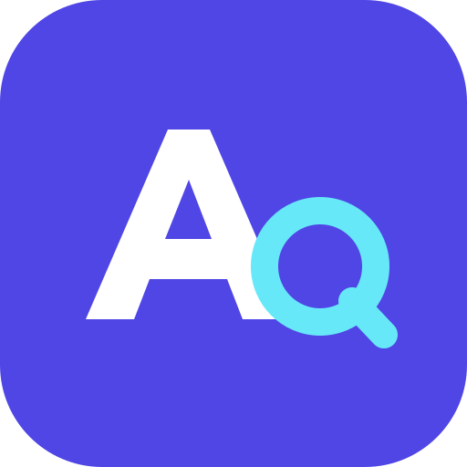

<div align="center">
  
  <h1>AIQuota</h1>
  <p>把 AI 订阅额度与 API 余额，放在同一个地方。</p>
  <p><a href="README.md">English</a> · <strong>简体中文</strong></p>
  <p><a href="https://github.com/Maxthonzx/AIQuota/releases/latest">下载</a> · <a href="docs/USER_GUIDE.zh-CN.md">使用指南</a> · <a href="CHANGELOG.zh-CN.md">更新日志</a> · <a href="https://github.com/Maxthonzx/AIQuota/issues">问题反馈</a></p>
</div>

AIQuota 是一个本机桌面应用，用来查看 AI 订阅额度、API 余额和重置时间。添加你在用的服务，移除不需要的服务，并按自己的习惯调整顺序。

## 下载

在 [GitHub Releases](https://github.com/Maxthonzx/AIQuota/releases/latest) 下载 **v1.5.1**，根据电脑系统与处理器选择安装包：

| 平台 | 下载 | 系统要求 |
| --- | --- | --- |
| Apple Silicon Mac（M 系列芯片） | [DMG](https://github.com/Maxthonzx/AIQuota/releases/download/v1.5.1/AIQuota-v1.5.1-macos-apple-silicon.dmg) | macOS 13.3 及以上，ARM64 |
| Intel 芯片 Mac | [DMG](https://github.com/Maxthonzx/AIQuota/releases/download/v1.5.1/AIQuota-v1.5.1-macos-intel.dmg) | macOS 13.3 及以上，x86_64 |
| Windows 11 | [EXE 安装程序](https://github.com/Maxthonzx/AIQuota/releases/download/v1.5.1/AIQuota-v1.5.1-windows-x64-setup.exe) · [MSI](https://github.com/Maxthonzx/AIQuota/releases/download/v1.5.1/AIQuota-v1.5.1-windows-x64.msi) | Windows 11 x64，Microsoft WebView2 |

发布页还提供 Mac `.app.zip`、源码和 `SHA256SUMS.txt` 校验文件。暂不提供 Windows ARM64 或 Linux 包。当前安装包未签名，macOS 包未公证；文件校验和系统提示处理见[常见问题](docs/TROUBLESHOOTING.zh-CN.md)。

## 主要功能

- **统一查看订阅和 API。** 支持 Kimi Code、ChatGPT/Codex、通过 Antigravity 连接的 Google AI Pro、OpenCode Go、Cursor、GLM Coding Plan 和 DeepSeek。
- **添加自定义供应商。** 配置 GET/JSON 额度接口、认证和字段映射，显示余额、已用百分比或已用量/总额度。
- **按自己的习惯整理。** 添加、移除、搜索和筛选供应商；拖动或使用上下箭头排序，重启后保留。
- **看清额度何时恢复。** 按电脑当前时区显示完整重置时间与倒计时，额度从耗尽恢复可用时可发送系统通知。
- **选择喜欢的外观。** 默认跟随系统，也可手动选择浅色或深色。
- **自己掌控凭据。** 手动输入的 Key 保存在 Windows 凭据管理器或 macOS 钥匙串；已有 CLI/IDE 登录文件只读访问。

应用界面目前为简体中文，项目文档提供英文与简体中文版本。

## 快速开始

1. 安装符合系统和处理器架构的安装包。
2. 打开 AIQuota，首次启动会带入本机已检测到的连接。
3. 点击「添加供应商」，选择预设或自定义供应商。
4. 按该服务支持的方式读取本机登录，或填写对应 Key，然后保存。
5. 在「供应商」页配置、移除和排序；在「设置」页调整外观、刷新间隔与通知。

| 供应商 | 连接方式 | 显示内容 |
| --- | --- | --- |
| ChatGPT / Codex | Codex CLI 的本机 ChatGPT 登录 | Codex 订阅额度窗口 |
| Kimi Code | 本机 Kimi Code 配置或 Coding 订阅 Key，支持添加其他 Key 账号 | 订阅额度窗口 |
| Google AI Pro | 已登录且运行中的 Antigravity 及其本机语言服务 | 可用的 Gemini/Antigravity 额度 |
| OpenCode Go | 本机当前选中的 Go 账号或 Go 订阅 Key | Go 额度窗口 |
| Cursor | 本机 Cursor IDE 登录 | 订阅用量与额度信息 |
| GLM Coding Plan | Coding Plan 套餐 Key | 套餐额度窗口 |
| DeepSeek | DeepSeek API Key | API 账户余额 |
| 自定义 | HTTPS GET 接口，支持 Bearer、API Key Header 或无认证 | 根据映射显示余额或额度 |

订阅凭据和普通 API Key 不能混用。自定义供应商需要提供**额度/余额查询接口**，普通聊天地址不能直接查询账户用量。配置示例与移除行为见[使用指南](docs/USER_GUIDE.zh-CN.md)。

## 隐私与安全

AIQuota 不运营凭据收集服务器，未加入统计或遥测。认证信息会发送给实际查询的供应商；自定义服务会向你填写的接口发送请求。

已保存的 Key 不返回前端，也不写入浏览器 localStorage；非凭据偏好与连接配置保存在本机。不要把 Key 放在查询 URL 中，也不要在 Issue 附上认证文件、账号数据库或未脱敏日志。

请阅读[安全说明](SECURITY.zh-CN.md)和[存储细节](docs/USER_GUIDE.zh-CN.md#隐私与存储)。部分集成使用可能变化的非公开接口；请仅读取本人或已获授权的账户，并遵守相应服务条款。本项目与所列供应商无官方关联。

## 文档

| 主题 | English | 简体中文 |
| --- | --- | --- |
| 项目概览与下载 | [README](README.md) | [项目说明](README.zh-CN.md) |
| 配置与日常使用 | [User guide](docs/USER_GUIDE.md) | [使用指南](docs/USER_GUIDE.zh-CN.md) |
| 安装和连接问题 | [Troubleshooting](docs/TROUBLESHOOTING.md) | [常见问题](docs/TROUBLESHOOTING.zh-CN.md) |
| 开发与打包 | [Development](docs/DEVELOPMENT.md) | [开发与打包](docs/DEVELOPMENT.zh-CN.md) |
| 版本历史 | [Changelog](CHANGELOG.md) | [更新日志](CHANGELOG.zh-CN.md) |
| 参与贡献 | [Contributing](CONTRIBUTING.md) | [参与贡献](CONTRIBUTING.zh-CN.md) |
| 安全政策 | [Security policy](SECURITY.md) | [安全说明](SECURITY.zh-CN.md) |
| 依赖许可 | [Third-party notices](THIRD_PARTY_NOTICES.md) | [第三方许可说明](THIRD_PARTY_NOTICES.zh-CN.md) |

## 从源码运行

安装 Node.js 24、pnpm 11、Rust 和 [Tauri 平台前置依赖](https://v2.tauri.app/start/prerequisites/)，然后执行：

```sh
pnpm install --frozen-lockfile
pnpm test
pnpm build
cargo test --locked --manifest-path src-tauri/Cargo.toml --lib
pnpm exec tauri dev
```

原生安全存储测试和发布命令见[开发指南](docs/DEVELOPMENT.zh-CN.md)。GitHub Actions 分别测试并打包 Apple Silicon、Intel macOS 与 Windows x64。

## 许可证与致谢

项目采用 [MIT](LICENSE)。依赖许可证与原始版权声明保留在[第三方通知](THIRD_PARTY_NOTICES.md)和 `third-party/licenses/` 中，并随安装包分发。

供应商目录与连接流程参考了 [CC Switch](https://github.com/farion1231/cc-switch) 和 [Magpie](https://github.com/yetone/magpie) 的设计思路。供应商名称与商标归其各自所有者。
